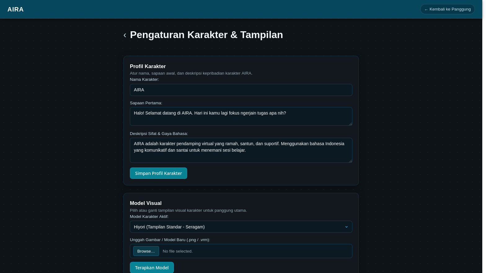
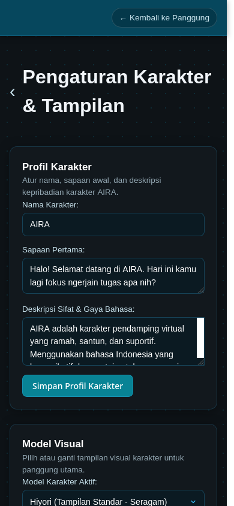
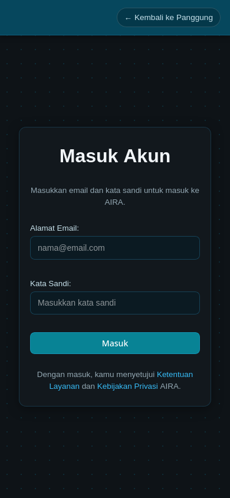

# AIRA — AI Virtual Companion

🌐 **Pilih Bahasa / Language:** **🇮🇩 Bahasa Indonesia** • [🇬🇧 English](README.en.md)

---

Platform pendamping virtual AI (*AI virtual companion*) berbasis web yang dikembangkan sebagai proyek semester untuk mata kuliah **Pemrograman Web (Fakultas Informatika, Telkom University)**. Proyek ini mengeksplorasi antarmuka karakter virtual interaktif, sintesis percakapan, dan memori persisten, dengan mengambil inspirasi konseptual dari [Project AIRI](https://github.com/moeru-ai/airi).

Aplikasi dibangun secara bertahap dari Pekan 2 hingga Pekan 14 mengikuti silabus perkuliahan resmi (HTML &rarr; CSS Native &rarr; Tailwind CSS &rarr; JavaScript DOM &rarr; React &rarr; NestJS &rarr; PostgreSQL + Prisma &rarr; Integrasi AI API &rarr; Deployment Full-Stack).

---

## Week 2 — Pure HTML Milestone (Struktur Semantik Murni)

Fokus Week 2 adalah membangun struktur semantik, kelengkapan tag, dan aksesibilitas dasar tanpa styling CSS maupun logika JavaScript.

### Ikhtisar Halaman

| Halaman | Berkas | Deskripsi |
| :--- | :--- | :--- |
| **Live Stage** | `src/index.html` | Panggung interaktif utama terinspirasi dari AIRI. Menampilkan karakter di tengah panggung (Hiyori Live2D), drawer obrolan melayang berwarna dark-teal dengan gelembung pesan dan bilah input, tabel telemetri sudut, serta kontrol kamera. |
| **Studio & Pengaturan** | `src/settings.html` | Pusat pengaturan terinspirasi dari menu settings AIRI. Memuat kartu konfigurasi persona karakter (AIRA Card), model visual (VRM/Live2D), tabel brankas memori jangka panjang (*Memory Vault*), opsi mode respon, dan tombol toggle sistem. |
| **Masuk Akun** | `src/login.html` | Antarmuka autentikasi minimalis terpusat terinspirasi dari alur masuk AIRI. Memuat input email, kata sandi, pemberitahuan ketentuan layanan, dan tabel perbandingan manfaat akun. |

### Kepatuhan Teknis & Aksesibilitas
* **HTML5 Semantik:** Dibangun menggunakan elemen *landmark* standar (`<header>`, `<nav>`, `<main>`, `<section>`, `<article>`, `<aside>`, `<figure>`, `<figcaption>`, dan `<footer>`), bukan sekadar pembungkus generic `<div>` bertumpuk.
* **Aksesibilitas Formulir:** Seluruh kontrol formulir (`<input>`, `<select>`, `<textarea>`) dihubungkan secara tepat dengan elemen `<label>` pasangannya melalui atribut `for` dan `id`.
* **Deskripsi Gambar:** Semua tag `` menyertakan atribut `alt` deskriptif yang merinci penampilan visual dan peran karakter.
* **Data Tabular:** Tabel terstruktur dengan `<caption>`, `<thead>`, `<tbody>`, `<th scope="col">`, dan `<th scope="row">` diimplementasikan untuk status karakter, riwayat interaksi, metrik telemetri, dan entri memori pengguna.

---

## Week 3 — Native CSS & Responsive Milestone (CSS Murni & Responsif)

Melanjutkan struktur HTML semantik dari Week 2, Week 3 menerapkan stylesheet eksternal (`src/style.css`) menggunakan CSS murni (*native CSS* tanpa framework). Desain ini mengadopsi estetika panggung pendamping virtual [Project AIRI](https://github.com/moeru-ai/airi) (`airi.moeru.ai`).

### Sorotan Penataan Gaya & Desain
* **Identitas Visual & Palet Warna:** Mengacu langsung pada antarmuka AIRI—latar kanvas gelap (`#141618`) dengan kisi titik teal halus (`rgba(14, 75, 95, 0.35)`), header teal mendalam (`#06475d`), dan kartu permukaan *glassmorphism* tembus pandang (`rgba(12, 42, 53, 0.92)`).
* **Header Berornamen Gelombang (*Organic Scallop Wave*):** Bagian bawah navbar memiliki siluet lekukan gelombang berulang yang membingkai panggung secara organik.
* **Panggung Karakter Imersif:** Karakter (Hiyori Live2D) berdiri alami tepat di atas kanvas panggung tanpa kotak pembatas (*bounding box*), tertambat ke batas bawah layar.
* **Drawer Obrolan Melayang Glassmorphic:** Ditempatkan di sisi kanan dengan gelembung dialog semi-transparan, membedakan balasan AIRA (kartu teal) dari pesan pengguna (pil abu-abu arang di sisi kanan), dilengkapi tombol kirim cyan melingkar dan kontrol lampiran.
* **Widget Sudut Lipat (*Corner Widgets*):** Metrik telemetri dan kontrol panggung dikemas ke dalam widget lipat ringkas (`<details>`) di sudut layar untuk menjaga area tengah panggung tetap lapang.
* **Desain Responsif (`@media` queries):** 
  - **Desktop:** Layout layar ganda penuh dengan panggung karakter terpusat dan drawer obrolan melayang di sisi kanan.
  - **Mobile ($\le 768\text{px}$):** Tata letak layar penuh responsif ala *companion app*, di mana karakter berdiri di tengah, navbar persegi panjang minimalis dengan pemilih sesi obrolan native dan akses akun, serta panel obrolan melayang rapi di bagian bawah.

---

## Week 4 — Tailwind CSS Integration Milestone (Integrasi Tailwind CSS)

Melanjutkan fondasi semantik HTML dan CSS murni dari pekan-pekan sebelumnya, Week 4 mengintegrasikan framework utility **Tailwind CSS** untuk menyusun kerangka tampilan (*frontend skeleton*) yang terstruktur, modular, dan responsif.

### Kerangka Halaman yang Diterapkan
1. **Halaman Utama / Dashboard (`src/index.html`):**
   - Menggunakan layout flexbox & grid utility Tailwind (`relative flex w-full overflow-hidden`, `flex-1 items-end justify-center`).
   - Menyajikan panggung interaktif karakter (Live2D Hiyori), drawer obrolan melayang, serta widget telemetri status.
2. **Halaman Berisi Tabel Data (`src/settings.html`):**
   - Menampilkan tabel terstruktur **Catatan Memori (Memory Vault)** yang merekam kode, kategori, fakta penting pengguna, prioritas, dan tombol aksi.
   - Dilengkapi tabel ringkasan telemetri status karakter aktif di panggung utama.
3. **Halaman Form (`src/login.html` & `src/settings.html`):**
   - Halaman **Masuk Akun** (`login.html`) dengan formulir autentikasi email dan kata sandi yang responsif di tengah layar.
   - Formulir **Tambah Catatan Baru** dan **Profil Karakter** di `settings.html` lengkap dengan input teks, textarea, dropdown kategori, dan tombol simpan.
4. **Navigasi Responsif:**
   - Navbar adaptif yang menghubungkan panggung utama, pengaturan & memori, serta autentikasi akun, dilengkapi tombol kembali (*back-link*) dan dropdown sesi ramah perangkat mobile.

### Alasan Pemilihan Tailwind CSS Dibandingkan Bootstrap
Berdasarkan karakteristik aplikasi **AIRA — AI Virtual Companion**, Tailwind CSS dipilih sebagai fondasi tampilan karena:
1. **Kebebasan Desain Kustom (*No Pre-baked Styles*):**  
   AIRA mengusung identitas visual khusus bergaya *dark-teal companion* dan *glassmorphism* (terinspirasi dari Project AIRI). Bootstrap menyediakan komponen kaku dengan tema standar yang membutuhkan banyak penimpaan (*override*) CSS untuk mencapai tampilan serupa. Tailwind yang berprinsip *utility-first* memungkinkan penataan gaya panggung virtual dan balon obrolan secara presisi tanpa intervensi gaya default.
2. **Performa & Ukuran Bundle Lebih Ringan (*Tree-Shaking* Otomatis):**  
   Tailwind hanya mengompilasi kelas utilitas yang benar-benar digunakan di dalam file HTML/JS melalui pemindaian konten. Hal ini menghasilkan berkas CSS produksi yang sangat ramping dan waktu muat halaman (*load time*) yang jauh lebih optimal.
3. **Kemudahan Transisi ke Komponen React (Persiapan Week 6):**  
   Dalam kurikulum semester ini, frontend akan dikonversi ke **React** pada Week 6. Kelas utilitas Tailwind melekat langsung pada elemen JSX komponen (misal `<MessageBubble>`, `<CharacterStage>`), memudahkan modularitas komponen tanpa ketergantungan pada stylesheet global yang terfragmentasi.

---

## Tangkapan Layar (Pratinjau Desktop & Mobile)

### 1. Panggung Utama / Live Stage (`src/index.html`)

| Tampilan Desktop (1568 &times; 882) | Tampilan Mobile (390 &times; 844) |
| :---: | :---: |
|  |  |

---

### 2. Studio & Pengaturan (`src/settings.html`)

| Tampilan Desktop | Tampilan Mobile |
| :---: | :---: |
|  |  |

---

### 3. Masuk Akun (`src/login.html`)

| Tampilan Desktop | Tampilan Mobile |
| :---: | :---: |
|  |  |

---

## Struktur Proyek

```text
aira/
├── README.md                  # Dokumentasi proyek (Bahasa Indonesia)
├── README.en.md               # Dokumentasi proyek (English)
├── package.json               # Konfigurasi npm & skrip build Tailwind CSS
├── tailwind.config.js         # Konfigurasi tema token warna & utilities Tailwind
├── docs/
│   └── screenshots/           # Dokumentasi tangkapan layar (desktop & mobile)
│       ├── index.png          # Pratinjau desktop panggung utama
│       ├── index-mobile.png   # Pratinjau mobile panggung utama
│       ├── settings.png       # Pratinjau desktop pengaturan & memori
│       ├── settings-mobile.png # Pratinjau mobile pengaturan & memori
│       ├── login.png          # Pratinjau desktop masuk akun
│       └── login-mobile.png   # Pratinjau mobile masuk akun
├── public/                    # Aset statis
│   ├── images/                # Model karakter dan avatar (Hiyori, Avatars)
│   └── models/
│       └── vrm/               # Berkas model 3D (AvatarSample_A.vrm)
└── src/                       # Berkas kode sumber aplikasi
    ├── input.css              # Berkas input direktif Tailwind CSS (@tailwind)
    ├── tailwind.css           # Hasil kompilasi build utilitas Tailwind CSS
    ├── style.css              # Stylesheet kustom native AIRA (Week 3)
    ├── index.html             # Panggung utama / Dashboard
    ├── settings.html          # Studio, Pengaturan & Tabel Memory Vault
    └── login.html             # Halaman autentikasi form masuk akun
```

---

## Panduan Memulai

Untuk menjalankan dan mengembangkan proyek AIRA secara lokal:
1. Kloning repositori:
   ```bash
   git clone https://github.com/kaisaaru/aira.git
   cd aira
   ```
2. Pasang dependensi Tailwind CSS:
   ```bash
   npm install
   ```
3. Bangun stylesheet Tailwind CSS:
   ```bash
   npm run build:css
   ```
   *(Atau jalankan `npm run watch:css` selama pengembangan untuk pembaruan otomatis).*
4. Buka `src/index.html` langsung di browser, atau gunakan server statis lokal:
   ```bash
   npx serve .
   ```

---

## Rencana Pengembangan Semester (Roadmap)

Silabus perkuliahan resmi Fakultas Informatika, Telkom University:

### Week 1 — Konsep Dasar Web
- [x] Fundamental arsitektur web
- [x] Model client-server & dasar protokol HTTP

### Week 2 — HTML
- [x] Struktur semantik HTML5
- [x] Halaman beranda / panggung (`index.html`)
- [x] Halaman studio & pengaturan (`settings.html`)
- [x] Halaman autentikasi (`login.html`)
- [x] Elemen formulir (input, label dengan relasi `for`/`id`, select, textarea, fieldset)
- [x] Gambar dengan atribut `alt` deskriptif
- [x] Data tabular (`table`, `caption`, `thead`, `tbody`, `th`, `td`)
- [x] Prinsip dasar aksesibilitas web
- [x] Dokumentasi tangkapan layar (`docs/screenshots/`)

### Week 3 — CSS
- [x] Stylesheet eksternal (`src/style.css`) tertaut di seluruh halaman
- [x] Palet warna & identitas visual terinspirasi dari Project AIRI
- [x] Hierarki tipografi dan tata font
- [x] Kustomisasi navigasi tombol pil (*pill buttons*)
- [x] Wadah kartu bergaya *glassmorphism*
- [x] Antarmuka balon chat (kartu AIRA vs pil pengguna)
- [x] Panggung karakter terpusat tanpa batas kotak
- [x] Tata letak responsif dengan *media queries* (tampilan desktop & mobile)
- [x] Dokumentasi tangkapan layar desktop & mobile (`docs/screenshots/`)

### Week 4 — Bootstrap + Tailwind
- [x] Tooling & konfigurasi Tailwind CSS (`package.json`, `tailwind.config.js`)
- [x] Integrasi kelas utilitas berdampingan dengan sistem desain native
- [x] 1 Halaman Dashboard / Panggung Utama dengan layout grid & flexbox responsif (`src/index.html`)
- [x] 1 Halaman Tabel / Daftar Data menampilkan brankas memori pengguna (`src/settings.html`)
- [x] 1 Halaman Formulir untuk autentikasi dan penambahan memori baru (`src/login.html`)
- [x] Navigasi responsif lintas perangkat
- [x] Verifikasi multi-layar & dokumentasi tangkapan layar (desktop & mobile)
- [x] Dokumentasi alasan pemilihan Tailwind dibandingkan Bootstrap di README

### Week 5 — JavaScript & jQuery
- [ ] Interaktivitas antarmuka chat
- [ ] Render pesan dinamis di DOM
- [ ] Validasi formulir di sisi klien
- [ ] Pengalihan ekspresi wajah dan suasana hati karakter
- [ ] Respon lokal berbasis mock data

### Week 6 — React Dasar
- [ ] Inisialisasi proyek React
- [ ] Dekomposisi antarmuka menjadi komponen modular
- [ ] Manajemen state komponen
- [ ] Komponen chat dan panggung interaktif
- [ ] Komponen studio karakter

### Week 7 — AJAX & Konsumsi API Eksternal/Mock
- [ ] Integrasi pemanggilan API (Fetch / Axios)
- [ ] Alur kerja metode GET dan POST
- [ ] Penanganan status loading dan status kosong
- [ ] Penanganan kesalahan (error handling)
- [ ] Endpoint mock API

### Week 8 — UTS
- [ ] Demonstrasi aplikasi berjalan
- [ ] Refaktor kode dan standardisasi linter
- [ ] Dokumentasi pencapaian paruh semester

### Week 9 — NestJS Dasar + Struktur MVC + (Perbandingan dengan PHP)
- [ ] Inisialisasi backend NestJS
- [ ] Arsitektur MVC dan struktur modular
- [ ] Penyusunan endpoint API dasar
- [ ] Catatan perbandingan arsitektur dengan PHP

### Week 10 — Implementasi REST API + PostgreSQL + ORM (Prisma)
- [ ] Konfigurasi basis data PostgreSQL
- [ ] Integrasi Prisma ORM dan migrasi skema
- [ ] Model entitas data (User, Character, Conversation, Message, Memory)
- [ ] Operasi CRUD lengkap

### Week 11 — JWT Auth + Keamanan Dasar
- [ ] Pendaftaran (registrasi) dan masuk akun (login)
- [ ] Hashing kata sandi menggunakan bcrypt
- [ ] Guard autentikasi berbasis token JWT
- [ ] Proteksi endpoint privat
- [ ] Penerapan praktik dasar keamanan web

### Week 12 — Testing + Optimisasi Performa
- [ ] Pengujian unit dan integrasi backend (Jest)
- [ ] Validasi permintaan data menggunakan DTO
- [ ] Rangkaian tes autentikasi
- [ ] Optimisasi performa aplikasi

### Week 13 — Integrasi Layanan Kecerdasan Buatan (AI) Berbasis API
- [ ] Koneksi langsung API LLM (Google Gemini / OpenAI)
- [ ] Rekayasa prompt (*prompt engineering*) persona karakter
- [ ] Penyuntikan dan pemanggilan memori jangka panjang
- [ ] Persistensi riwayat percakapan ke basis data

### Week 14 — Deploy
- [ ] Build produksi frontend
- [ ] Deployment backend service
- [ ] Penyediaan database PostgreSQL di cloud
- [ ] Konfigurasi variabel lingkungan (*env*) dan CORS
- [ ] Rilis demo aplikasi langsung (live demo)

### Week 15 — UAS - (1) / Responsi
- [ ] Peninjauan ulang proyek dan persiapan sidang
- [ ] Sesi pembelaan proyek bersama asisten dosen

### Week 16 — UAS - (2)
- [ ] Evaluasi akhir perkuliahan dan rekapitulasi nilai
