# AIRA — AI Virtual Companion

🌐 **Pilih Bahasa / Language:** **🇮🇩 Bahasa Indonesia** • [🇬🇧 English](README.en.md)

---

Platform pendamping virtual AI (*AI virtual companion*) berbasis web yang dikembangkan sebagai proyek semester untuk mata kuliah **Pemrograman Web (Fakultas Informatika, Telkom University)**. Proyek ini mengeksplorasi antarmuka karakter virtual interaktif, sintesis percakapan, dan memori persisten, dengan mengambil inspirasi konseptual dari [Project AIRI](https://github.com/moeru-ai/airi).

Aplikasi dibangun secara bertahap dari Pekan 2 hingga Pekan 14 mengikuti silabus perkuliahan resmi (HTML &rarr; CSS Native &rarr; Tailwind CSS &rarr; JavaScript DOM &rarr; React &rarr; NestJS &rarr; PostgreSQL + Prisma &rarr; Integrasi AI API &rarr; Deployment Full-Stack).

---

## Week 2 — Pure HTML Milestone (Struktur Semantik Murni)

Fokus Week 2 adalah membangun struktur semantik, kelengkapan tag, dan aksesibilitas dasar tanpa styling CSS maupun logika JavaScript.

### Ikhtisar Halaman

| Halaman                 | Berkas              | Deskripsi                                                                                                                                                                                                                                  |
| :---------------------- | :------------------ | :----------------------------------------------------------------------------------------------------------------------------------------------------------------------------------------------------------------------------------------- |
| **Live Stage**          | `src/index.html`    | Panggung interaktif utama terinspirasi dari AIRI. Menampilkan karakter di tengah panggung (Hiyori Live2D), drawer obrolan melayang berwarna dark-teal dengan gelembung pesan dan bilah input, tabel telemetri sudut, serta kontrol kamera. |
| **Studio & Pengaturan** | `src/settings.html` | Pusat pengaturan terinspirasi dari menu settings AIRI. Memuat kartu konfigurasi persona karakter (AIRA Card), model visual (VRM/Live2D), tabel brankas memori jangka panjang (*Memory Vault*), opsi mode respon, dan tombol toggle sistem. |
| **Masuk Akun**          | `src/login.html`    | Antarmuka autentikasi minimalis terpusat terinspirasi dari alur masuk AIRI. Memuat input email, kata sandi, pemberitahuan ketentuan layanan, dan tabel perbandingan manfaat akun.                                                          |

### Kepatuhan Teknis & Aksesibilitas
* **HTML5 Semantik:** Dibangun menggunakan elemen *landmark* standar (`<header>`, `<nav>`, `<main>`, `<section>`, `<article>`, `<aside>`, `<figure>`, `<figcaption>`, dan `<footer>`), bukan sekadar pembungkus generic `<div>` bertumpuk.
* **Aksesibilitas Formulir:** Seluruh kontrol formulir (`<input>`, `<select>`, `<textarea>`) dihubungkan secara tepat dengan elemen `<label>` pasangannya melalui atribut `for` dan `id`.
* **Deskripsi Gambar:** Semua tag `` menyertakan atribut `alt` deskriptif yang merinci penampilan visual dan peran karakter.
* **Data Tabular:** Tabel terstruktur dengan `<caption>`, `<thead>`, `<tbody>`, `<th scope="col">`, dan `<th scope="row">` diimplementasikan untuk status karakter, riwayat interaksi, metrik telemetri, dan entri memori pengguna.

---

## Week 3 — Native CSS & Responsive Milestone (CSS Murni & Responsif)

Melanjutkan struktur HTML semantik dari Week 2, Week 3 menerapkan stylesheet eksternal (`src/style.css`) menggunakan CSS murni (*native CSS* tanpa framework). Desain ini mengadopsi estetika panggung pendamping virtual [Project AIRI](https://github.com/moeru-ai/airi) (`airi.moeru.ai`).

### Sorotan Penataan Gaya & Desain
* **Identitas Visual & Palet Warna:** Mengacu langsung pada antarmuka AIRI—latar kanvas gelap (`#141618`) dengan kisi titik teal halus (`rgba(14, 75, 95, 0.35)`), header teal mendalam (`#06475d`), dan kartu permukaan *glassmorphism* tembus pandang (`rgba(12, 42, 53, 0.92)`).
* **Header Berornamen Gelombang (*Organic Scallop Wave*):** Bagian bawah navbar memiliki siluet lekukan gelombang berulang yang membingkai panggung secara organik.
* **Panggung Karakter Imersif:** Karakter (Hiyori Live2D) berdiri alami tepat di atas kanvas panggung tanpa kotak pembatas (*bounding box*), tertambat ke batas bawah layar.
* **Drawer Obrolan Melayang Glassmorphic:** Ditempatkan di sisi kanan dengan gelembung dialog semi-transparan, membedakan balasan AIRA (kartu teal) dari pesan pengguna (pil abu-abu arang di sisi kanan), dilengkapi tombol kirim cyan melingkar dan kontrol lampiran.
* **Widget Sudut Lipat (*Corner Widgets*):** Metrik telemetri dan kontrol panggung dikemas ke dalam widget lipat ringkas (`<details>`) di sudut layar untuk menjaga area tengah panggung tetap lapang.
* **Desain Responsif (`@media` queries):** 
  - **Desktop:** Layout layar ganda penuh dengan panggung karakter terpusat dan drawer obrolan melayang di sisi kanan.
  - **Mobile ($\le 768\text{px}$):** Tata letak layar penuh responsif ala *companion app*, di mana karakter berdiri di tengah, navbar persegi panjang minimalis dengan pemilih sesi obrolan native dan akses akun, serta panel obrolan melayang rapi di bagian bawah.

---

## Week 4 — Tailwind CSS Integration Milestone (Integrasi Tailwind CSS)

Melanjutkan fondasi semantik HTML dan CSS murni dari pekan-pekan sebelumnya, Week 4 mengintegrasikan framework utility **Tailwind CSS** untuk menyusun kerangka tampilan (*frontend skeleton*) yang terstruktur, modular, dan responsif.

### Kerangka Halaman yang Diterapkan
1. **Halaman Utama / Dashboard (`src/index.html`):**
   - Menggunakan layout flexbox & grid utility Tailwind (`relative flex w-full overflow-hidden`, `flex-1 items-end justify-center`).
   - Menyajikan panggung interaktif karakter (Live2D Hiyori), drawer obrolan melayang, serta widget telemetri status.
2. **Halaman Berisi Tabel Data (`src/settings.html`):**
   - Menampilkan tabel terstruktur **Catatan Memori (Memory Vault)** yang merekam kode, kategori, fakta penting pengguna, prioritas, dan tombol aksi.
   - Dilengkapi tabel ringkasan telemetri status karakter aktif di panggung utama.
3. **Halaman Form (`src/login.html` & `src/settings.html`):**
   - Halaman **Masuk Akun** (`login.html`) dengan formulir autentikasi email dan kata sandi yang responsif di tengah layar.
   - Formulir **Tambah Catatan Baru** dan **Profil Karakter** di `settings.html` lengkap dengan input teks, textarea, dropdown kategori, dan tombol simpan.
4. **Navigasi Responsif:**
   - Navbar adaptif yang menghubungkan panggung utama, pengaturan & memori, serta autentikasi akun, dilengkapi tombol kembali (*back-link*) dan dropdown sesi ramah perangkat mobile.

### Alasan Pemilihan Tailwind CSS Dibandingkan Bootstrap
Berdasarkan karakteristik aplikasi **AIRA — AI Virtual Companion**, Tailwind CSS dipilih sebagai fondasi tampilan karena:
1. **Kebebasan Desain Kustom (*No Pre-baked Styles*):**  
   AIRA mengusung identitas visual khusus bergaya *dark-teal companion* dan *glassmorphism* (terinspirasi dari Project AIRI). Bootstrap menyediakan komponen kaku dengan tema standar yang membutuhkan banyak penimpaan (*override*) CSS untuk mencapai tampilan serupa. Tailwind yang berprinsip *utility-first* memungkinkan penataan gaya panggung virtual dan balon obrolan secara presisi tanpa intervensi gaya default.
2. **Performa & Ukuran Bundle Lebih Ringan (*Tree-Shaking* Otomatis):**  
   Tailwind hanya mengompilasi kelas utilitas yang benar-benar digunakan di dalam file HTML/JS melalui pemindaian konten. Hal ini menghasilkan berkas CSS produksi yang sangat ramping dan waktu muat halaman (*load time*) yang jauh lebih optimal.
3. **Kemudahan Transisi ke Komponen React (Persiapan Week 6):**  
   Dalam kurikulum semester ini, frontend akan dikonversi ke **React** pada Week 6. Kelas utilitas Tailwind melekat langsung pada elemen JSX komponen (misal `<MessageBubble>`, `<CharacterStage>`), memudahkan modularitas komponen tanpa ketergantungan pada stylesheet global yang terfragmentasi.

---

## Week 5 — JavaScript & jQuery Milestone (Interaktivitas Sisi Client & Animasi UI)

Melanjutkan kerangka tampilan dari pekan-pekan sebelumnya, Week 5 mengintegrasikan berkas skrip eksternal (`src/script.js`) dan pustaka **jQuery 3.7.1** (via CDN) untuk menambahkan interaktivitas dinamis pada sisi klien tanpa membuat halaman HTML baru.

### Fitur & Implementasi Teknis

#### 1. JavaScript Murni (Vanilla JS)

##### A. Struktur Data Objek & Kamus Respon
* **`airaMemories` (Array of Objects):**  
  Menyimpan data catatan memori lokal pengguna dengan properti `id` (kode unik memori), `category` (Identitas, Minat, Kuliah), `fact` (informasi penting), `priority` (Utama, Penting, Sedang), dan `createdAt` (waktu pencatatan).
* **`airaResponses` (Kamus Respon Percakapan AI):**  
  Menyimpan basis data variasi balasan pendamping virtual AIRA yang dikelompokkan ke dalam 4 kategori kontekstual:
  - `greetings`: Koleksi sapaan ramah pembuka obrolan (misal: *"Halo juga! Senang bisa ngobrol lagi denganmu hari ini."*, *"Hai Kaisar! Ada yang bisa AIRA bantu untuk sesi belajarmu?"*).
  - `tasks`: Koleksi respon penyemangat aktivitas perkuliahan dan coding (misal: *"Semangat untuk tugas praktikumnya! Jangan lupa istirahat sejenak dan minum air ya."*, *"Wah, progres web programming kamu makin keren! Mau diskusikan bagian apa sekarang?"*).
  - `relax`: Koleksi respon saat pengguna merasa lelah atau mengantuk (misal: *"Santai sejenak yuk. Mungkin mendengarkan musik santai bisa bikin pikiran lebih segar."*, *"Kalau sudah lelah ngoding, istirahatkan matamu sebentar ya, Kaisar."*).
  - `defaultReplies`: Balasan umum adaptif untuk topik di luar kategori di atas (misal: *"Menarik sekali! Ceritakan lebih banyak tentang itu."*, *"AIRA mengerti. Fakta dan percakapan ini akan selalu kuingat dalam memori."*).

##### B. Fungsi Pengolahan Logika Data
* **`calculateMemoryStats(memories)`:**  
  Menerima array data memori dan melakukan perulangan native `.forEach()` untuk menghitung total entri serta memilah jumlah akumulasi berdasarkan tingkat prioritas (`utama`, `penting`, `sedang`). Mengembalikan objek ringkasan statistik `{ total, utama, penting, sedang }`.
* **`filterMemoriesByCategory(memories, category)`:**  
  Menyaring catatan memori menggunakan method native `.filter()`. Jika opsi yang dipilih bernilai `"all"` atau kosong, fungsi mengembalikan seluruh data; jika kategori tertentu dipilih, fungsi menyaring data tanpa terpengaruh perbedaan huruf besar/kecil (`toLowerCase()`).
* **`generateCompanionReply(userMessage)`:**  
  Mendeteksi kata kunci (*keyword matching*) pada pesan pengguna setelah dikonversi ke huruf kecil (`toLowerCase()`):
  - Mengandung kata sapaan (`halo`, `hai`, `pagi`, `siang`, `malam`) &rarr; memilih acak dari `airaResponses.greetings`.
  - Mengandung kata tugas/web (`tugas`, `kuliah`, `coding`, `web`, `pr`) &rarr; memilih acak dari `airaResponses.tasks`.
  - Mengandung kata lelah (`capek`, `lelah`, `istirahat`, `ngantuk`) &rarr; memilih acak dari `airaResponses.relax`.
  - Topik lainnya &rarr; memilih acak dari `airaResponses.defaultReplies`.  
  Pemilihan respon acak dilakukan menggunakan rumus `list[Math.floor(Math.random() * list.length)]`.
* **`getCurrentTimeString()`:**  
  Mengambil waktu lokal sistem melalui objek native `new Date()`, lalu mengekstrak jam (`getHours()`) dan menit (`getMinutes()`) dengan format 2 digit menggunakan `.padStart(2, "0")` sehingga menghasilkan string waktu standar `"HH:mm"`.
* **`renderMemoryTable(data)`:**  
  Menyusun dan menyuntikkan data memori ke dalam tabel HTML (`#memory-table-body`) secara native:
  - Mengosongkan isi tabel sebelumnya via `innerHTML = ""`.
  - Menampilkan baris status kosong khusus (`<tr><td colspan="5">...</td></tr>`) jika tidak ada data yang lolos filter.
  - Melakukan perulangan `.forEach()` untuk membentuk elemen baris `document.createElement("tr")`, menyematkan atribut `data-id`, merender badge prioritas berwarna (`#38bdf8` untuk Utama, `#2dd4bf` untuk Penting, `#94a8b3` untuk Sedang), menyertakan tombol aksi *Hapus*, dan menempelkannya ke DOM menggunakan `appendChild(tr)`.
* **`updateMemoryStatsDisplay()`:**  
  Memanggil `calculateMemoryStats(airaMemories)` dan memperbarui elemen DOM `#memory-stats-summary` di header tabel dengan ringkasan jumlah total dan badge rincian prioritas secara dinamis.

---

#### 2. jQuery (Event Handling, Validasi Sisi Klien & Animasi UI)

Seluruh logika jQuery diinisialisasi secara aman di dalam `$(document).ready(function () { ... })` agar berjalan tepat setelah struktur DOM siap:

##### A. Modul Masuk Akun (`src/login.html`)
* **Validasi Formulir Interaktif:** Menangkap event `.on('submit')` pada `.login-form` dan mencegah pengiriman form (`e.preventDefault()`) jika input tidak valid.
* **Verifikasi Email & Password:** Memeriksa field kosong serta menguji keabsahan pola email menggunakan Regular Expression (`^[^\s@]+@[^\s@]+\.[^\s@]+$`).
* **Umpan Balik Visual (Inline Error):** Field yang keliru otomatis diberi kelas border merah `.input-invalid`, kursor langsung diarahkan ke field pertama yang bermasalah (`.focus()`), dan pesan error muncul dengan animasi `slideDown(150)`.
* **Pembersihan Error Real-time:** Event `.on('input')` pada input email dan password secara otomatis menghapus border merah dan menyembunyikan pesan error via `slideUp(120)` begitu pengguna mulai mengetik perbaikan.

##### B. Modul Panggung Obrolan Interaktif (`src/index.html`)
* **Pengiriman Pesan Pengguna:** Menangkap event submit form chat, memvalidasi input tidak kosong, membentuk elemen balon pesan pengguna (`<article class="message-bubble user-message">`), memasukkannya ke wadah obrolan via `.append()`, dan menampilkannya dengan efek `fadeIn(300)`.
* **Animasi Indikator Mengetik:** Menampilkan gelembung `#typing-indicator` ("AIRA sedang mengetik...") menggunakan animasi `slideDown(200)` untuk memberikan ilusi percakapan manusiawi.
* **Simulasi Jeda Berpikir AI:** Menggunakan fungsi asynchronous `setTimeout(..., 800)` untuk menyembunyikan indikator via `slideUp(150)`, memproses balasan kontekstual via `generateCompanionReply()`, dan menampilkan balon pesan AI (`ai-message`) dengan efek `fadeIn(350)`.
* **Pengguliran Otomatis (*Auto-Scroll*):** Fungsi `scrollChatToBottom()` memanfaatkan method jQuery `.animate({ scrollTop: scrollHeight }, 300)` untuk memastikan pesan terbaru selalu berada di area pandang pengguna.
* **Shortcut Keyboard:** Event `.on('keydown')` pada textarea memungkinkan pengiriman pesan instan saat menekan tombol `Enter` (tanpa tombol `Shift`).

##### C. Modul Brankas Memori / Memory Vault (`src/settings.html`)
* **Buka/Tutup Form Akordeon:** Tombol `$("#toggle-memory-form-btn").on("click", ...)` membuka dan menutup form tambah catatan memori secara luwes dengan animasi `slideToggle(300)`, sekaligus memperbarui label tombol (`+ Tambah Catatan` &harr; `✕ Tutup Form`) dan memfokuskan kursor ke textarea.
* **Tombol Batal:** Tombol `#cancel-memory-form-btn` menutup form dengan `slideUp(250)` dan mereset seluruh indikator error.
* **Validasi Catatan Baru:** Saat form disubmit, sistem memastikan fakta memori tidak kosong. Jika kosong, border textarea menjadi merah (`.input-invalid`) dan pesan peringatan `#new-mem-error` muncul dengan animasi `slideDown(150)`.
* **Penyimpanan Data Dinamis:** Jika valid, data baru diberikan ID otomatis (`MEM-04`), di-push ke array `airaMemories`, tabel dirender ulang, ringkasan statistik diperbarui, formulir ditutup via `slideUp(250)`, dan notifikasi floating toast sukses dimunculkan.
* **Penyaringan Kategori Realtime:** Event `.on('change')` pada dropdown `#filter-memory-category` secara instan menyaring isi tabel tanpa perlu memuat ulang halaman (*page reload*).
* **Modal Konfirmasi Hapus Kustom:**
  - Klik tombol *Hapus* pada baris tabel menangkap ID memori dan memunculkan dialog modal kustom `#delete-modal` dengan efek `fadeIn(200)` di atas backdrop blur.
  - Klik tombol *Batal* atau klik area gelap di luar modal (*backdrop*) menutup modal via `fadeOut(200)`.
  - Klik tombol *Ya, Hapus Catatan* menutup modal, memudarkan baris tabel target dengan efek animasi `fadeOut(350)`, menghapus data dari memori, memperbarui statistik, dan memicu notifikasi toast penghapusan.
* **Floating Toast Notification (Gaya Kotori):**
  - Mengatur pesan notifikasi dinamis dan ikon Lucide SVG sesuai jenis aksi (centang cyan untuk penambahan sukses, tempat sampah merah mawar untuk penghapusan).
  - Menggeser kartu toast masuk dari kanan layar (`.show`).
  - Menjalankan animasi penyusutan garis waktu *progress bar* di bawah kartu menggunakan jQuery `.animate({ width: "0%" }, duration, "linear")`.
  - Otomatis menghilang dengan animasi slide-out ke kanan (`.hiding`) saat durasi habis atau saat tombol silang (`#close-toast-btn`) diklik.

---

### Demonstrasi Video Interaktivitas

Demonstrasi alur interaksi antarmuka sisi klien (validasi login, percakapan panggung, CRUD Memory Vault, filter data, dan modal kustom) didokumentasikan dalam video berikut:

<video src="docs/videos/week5_desktop.mp4" controls width="100%">
  Browser Anda tidak mendukung tag video. Anda dapat membuka atau mengunduh video langsung di <a href="docs/videos/week5_desktop.mp4">docs/videos/week5_desktop.mp4</a>.
</video>

---

### Tangkapan Layar Interaktivitas Week 5 (Before vs After)

Berikut dokumentasi kondisi antarmuka sebelum dan sesudah interaksi dijalankan:

#### 1. Validasi Formulir Masuk Akun (`src/login.html`)
|            Sebelum Interaksi (*Before* — 00:00)             |              Sesudah Validasi (*After* — 00:01)               |
| :---------------------------------------------------------: | :-----------------------------------------------------------: |
| 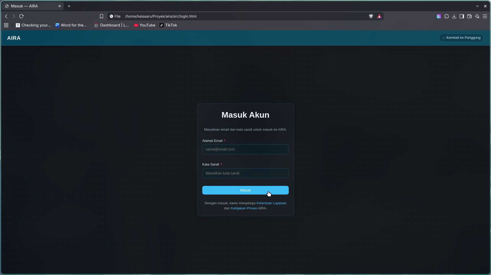 |   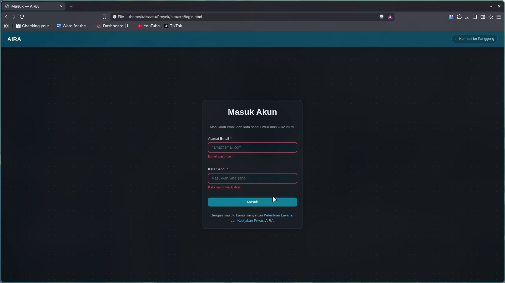   |
|      *Formulir kosong sebelum tombol "Masuk" ditekan*       | *Border merah dan pesan inline error muncul pada field wajib* |

---

#### 2. Live Chat Interaktif Panggung (`src/index.html`)
|           Sebelum Interaksi (*Before* — 00:09)            |                  Sesudah Interaksi (*After* — 00:19)                  |
| :-------------------------------------------------------: | :-------------------------------------------------------------------: |
| 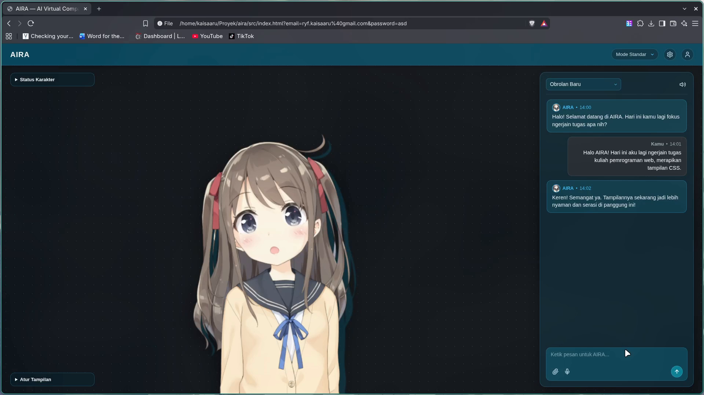 |        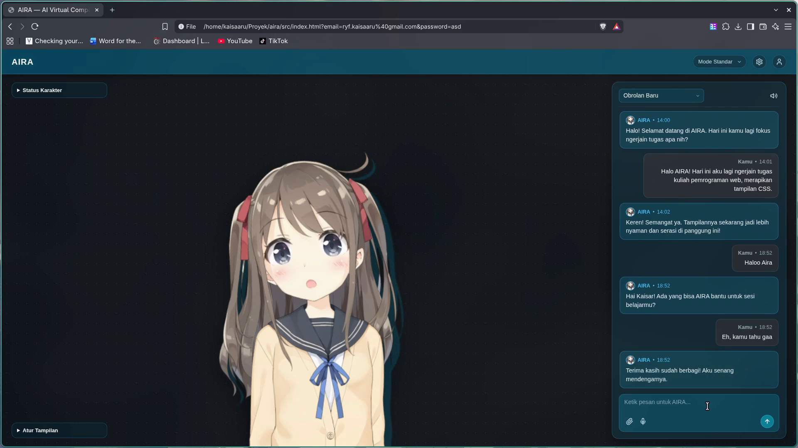        |
|    *Panggung obrolan saat pengguna mengetikkan pesan*     | *Balon pesan terkirim, indikator mengetik, dan balasan otomatis AIRA* |

---

#### 3. Buka/Tutup Form Tambah Memori (`src/settings.html`)
|                     Sebelum Dibuka (*Before* — 00:22)                     |                    Sesudah Dibuka (*After* — 00:24)                     |
| :-----------------------------------------------------------------------: | :---------------------------------------------------------------------: |
| 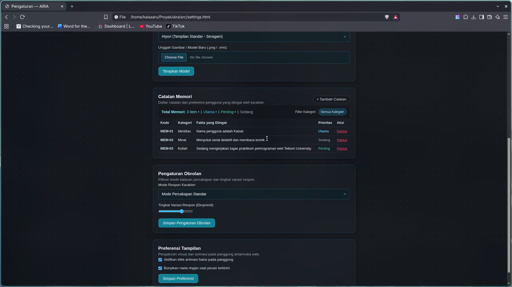 | 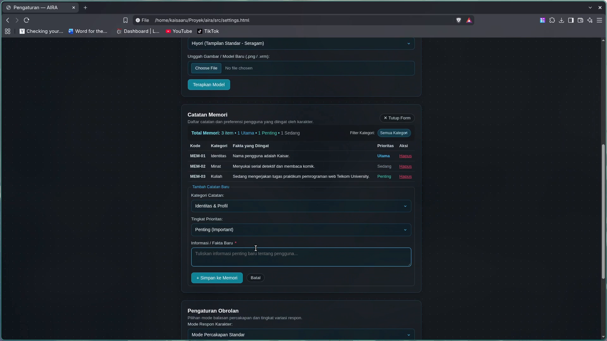 |
|              *Tabel memori dengan tombol "+ Tambah Catatan"*              |        *Formulir input terbuka mulus dengan animasi slideToggle*        |

---

#### 4. Validasi Form Tambah Memori (`src/settings.html`)
|                         Sebelum Disimpan (*Before* — 00:25)                         |                        Sesudah Validasi (*After* — 00:26)                         |
| :---------------------------------------------------------------------------------: | :-------------------------------------------------------------------------------: |
| 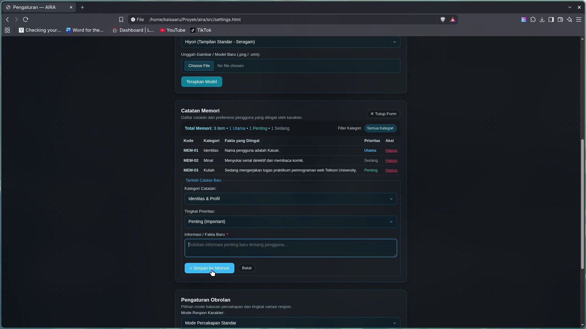 | 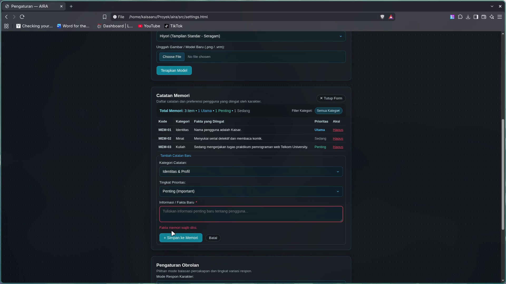 |
|                        *Field informasi fakta masih kosong*                         |            *Border merah dan pesan "Fakta memori wajib diisi." muncul*            |

---

#### 5. Tambah Data Memori Dinamis & Floating Toast (`src/settings.html`)
|                     Sebelum Disimpan (*Before* — 00:38)                     |                    Sesudah Disimpan (*After* — 00:40)                     |
| :-------------------------------------------------------------------------: | :-----------------------------------------------------------------------: |
|  | 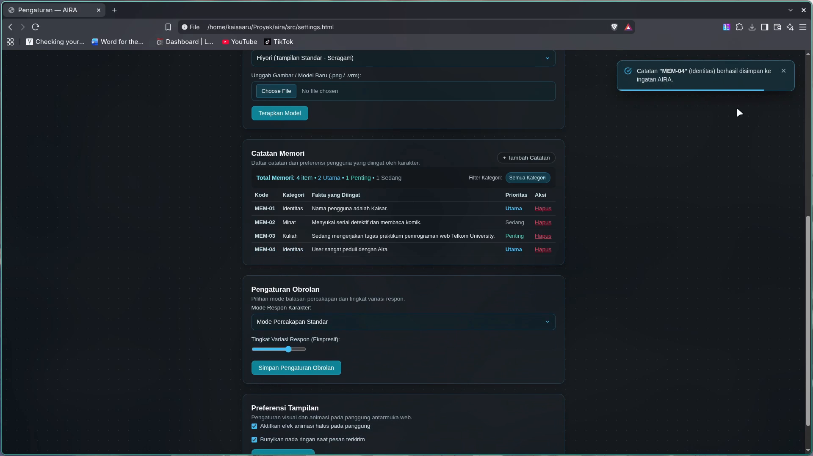 |
|                *Formulir terisi data fakta baru ("MEM-04")*                 |  *Baris baru masuk ke tabel, statistik bertambah, & toast sukses muncul*  |

---

#### 6. Filter Kategori Catatan Memori (`src/settings.html`)
|                        Sebelum Filter (*Before* — 00:44)                        |                        Sesudah Filter (*After* — 00:46)                         |
| :-----------------------------------------------------------------------------: | :-----------------------------------------------------------------------------: |
| 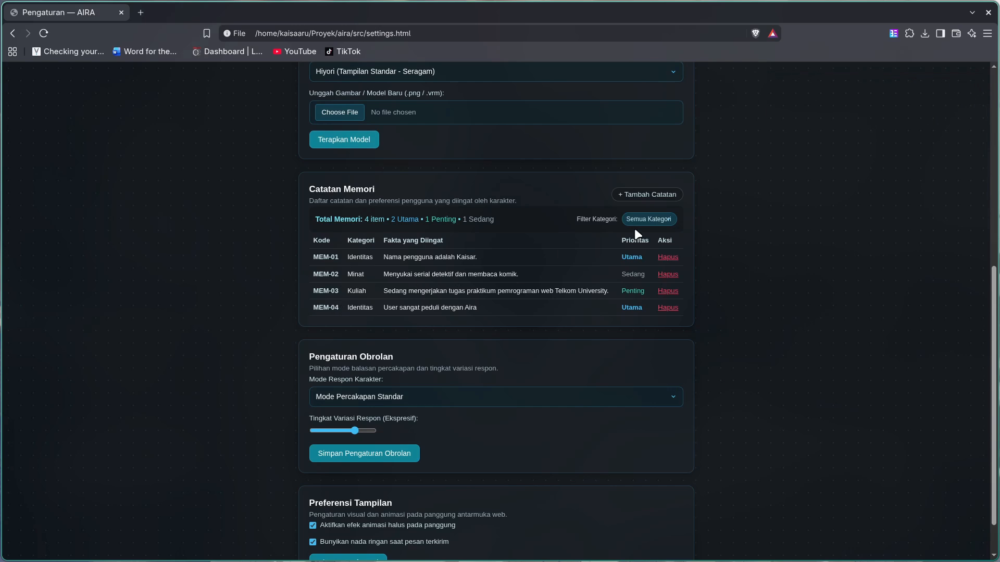 |  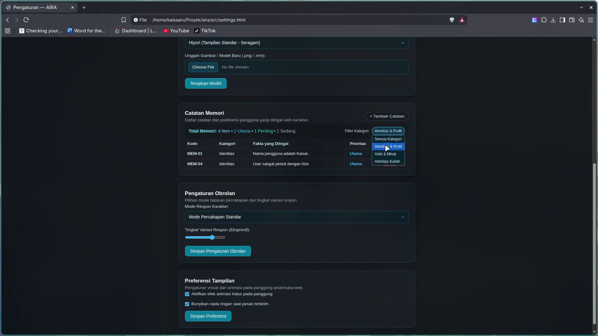  |
|                 *Tampilan awal seluruh data ("Semua Kategori")*                 | *Tabel terfilter seketika menampilkan kategori terpilih ("Identitas & Profil")* |

---

#### 7. Modal Konfirmasi & Penghapusan Catatan Memori (`src/settings.html`)
|                Sebelum Hapus / Buka Modal (*Before* — 00:53)                |                Sesudah Konfirmasi Hapus (*After* — 00:58)                 |
| :-------------------------------------------------------------------------: | :-----------------------------------------------------------------------: |
| 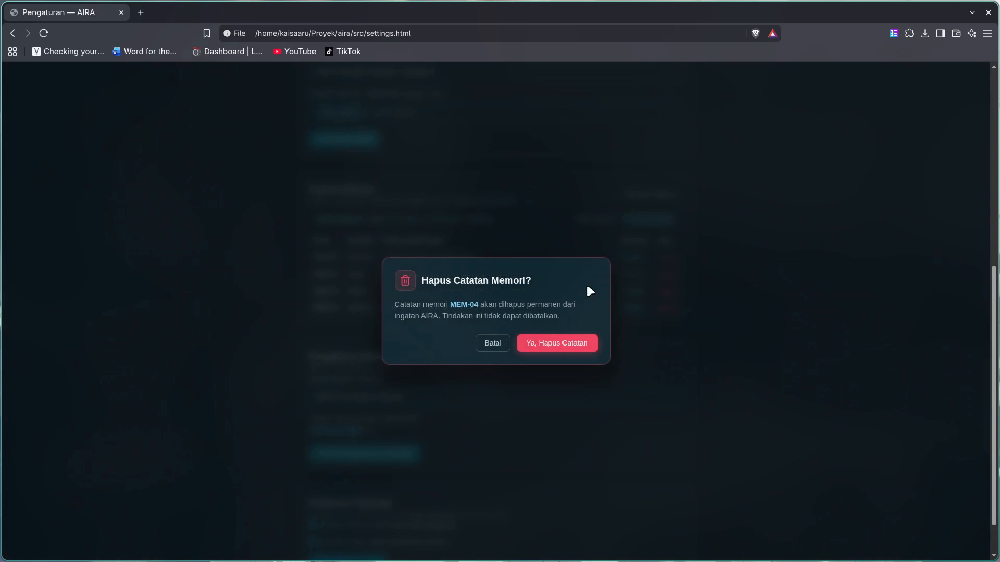 | 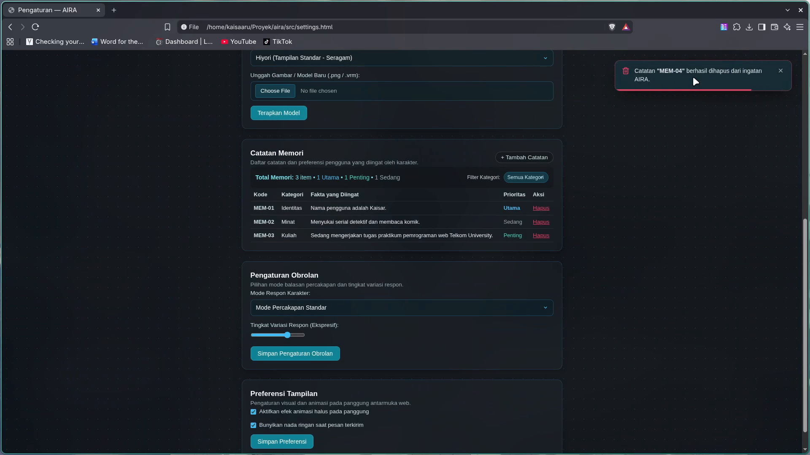 |
|        *Modal dialog konfirmasi kustom muncul dengan backdrop blur*         |    *Baris catatan memudar (fadeOut) dan toast notifikasi hapus muncul*    |

---

## Tangkapan Layar Halaman (Week 4 Multi-Device Previews)

### 1. Panggung Utama / Live Stage (`src/index.html`)

|           Tampilan Desktop (1568 &times; 882)           |               Tampilan Mobile (390 &times; 844)               |
| :-----------------------------------------------------: | :-----------------------------------------------------------: |
| 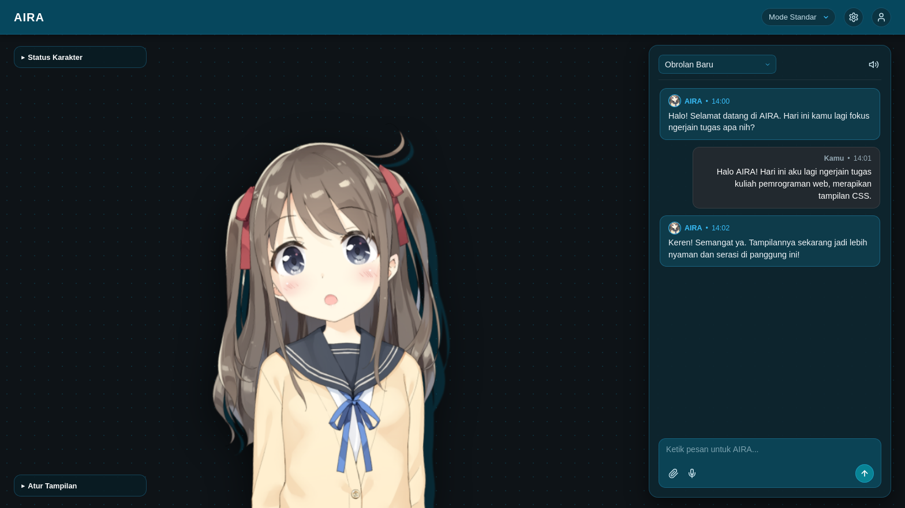 | 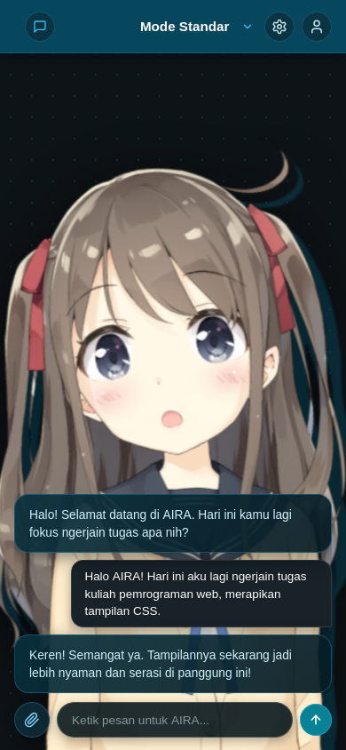 |

---

### 2. Studio & Pengaturan (`src/settings.html`)

|                     Tampilan Desktop                     |                        Tampilan Mobile                         |
| :------------------------------------------------------: | :------------------------------------------------------------: |
|  |  |

---

### 3. Masuk Akun (`src/login.html`)

|                   Tampilan Desktop                   |                      Tampilan Mobile                       |
| :--------------------------------------------------: | :--------------------------------------------------------: |
| 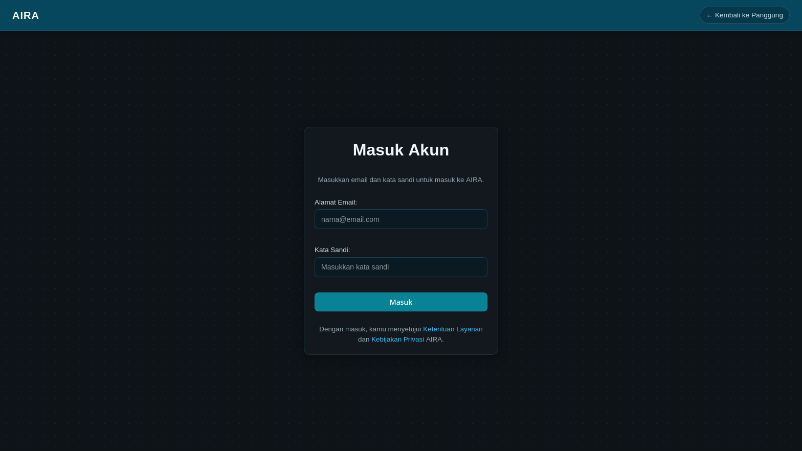 |  |

---

## Struktur Proyek

```text
aira/
├── README.md                  # Dokumentasi proyek (Bahasa Indonesia)
├── README.en.md               # Dokumentasi proyek (English)
├── package.json               # Konfigurasi npm & skrip build Tailwind CSS
├── tailwind.config.js         # Konfigurasi tema token warna & utilities Tailwind
├── docs/
│   ├── videos/                # Video rekaman demonstrasi fitur interaktif
│   │   └── week5_desktop.mp4  # Demonstrasi interaktivitas Week 5
│   └── screenshots/           # Dokumentasi tangkapan layar
│       ├── week5/             # Bukti interaktivitas Before vs After (Week 5)
│       └── week4/             # Pratinjau multi-device pekan sebelumnya (Week 4)
├── public/                    # Aset statis
│   ├── images/                # Model karakter dan avatar (Hiyori, Avatars)
│   └── models/
│       └── vrm/               # Berkas model 3D (AvatarSample_A.vrm)
└── src/                       # Berkas kode sumber aplikasi
    ├── input.css              # Berkas input direktif Tailwind CSS (@tailwind)
    ├── tailwind.css           # Hasil kompilasi build utilitas Tailwind CSS
    ├── style.css              # Stylesheet kustom native AIRA (Week 3)
    ├── script.js              # Logika JavaScript murni & animasi jQuery (Week 5)
    ├── index.html             # Panggung utama / Dashboard
    ├── settings.html          # Studio, Pengaturan & Tabel Memory Vault
    └── login.html             # Halaman autentikasi form masuk akun
```

---

## Panduan Memulai

Untuk menjalankan dan mengembangkan proyek AIRA secara lokal:
1. Kloning repositori:
   ```bash
   git clone https://github.com/kaisaaru/aira.git
   cd aira
   ```
2. Pasang dependensi Tailwind CSS:
   ```bash
   npm install
   ```
3. Bangun stylesheet Tailwind CSS:
   ```bash
   npm run build:css
   ```
   *(Atau jalankan `npm run watch:css` selama pengembangan untuk pembaruan otomatis).*
4. Buka `src/index.html` langsung di browser, atau gunakan server statis lokal:
   ```bash
   npx serve .
   ```

---

## Rencana Pengembangan Semester (Roadmap)

Silabus perkuliahan resmi Fakultas Informatika, Telkom University:

### Week 1 — Konsep Dasar Web
- [x] Fundamental arsitektur web
- [x] Model client-server & dasar protokol HTTP

### Week 2 — HTML
- [x] Struktur semantik HTML5
- [x] Halaman beranda / panggung (`index.html`)
- [x] Halaman studio & pengaturan (`settings.html`)
- [x] Halaman autentikasi (`login.html`)
- [x] Elemen formulir (input, label dengan relasi `for`/`id`, select, textarea, fieldset)
- [x] Gambar dengan atribut `alt` deskriptif
- [x] Data tabular (`table`, `caption`, `thead`, `tbody`, `th`, `td`)
- [x] Prinsip dasar aksesibilitas web
- [x] Dokumentasi tangkapan layar (`docs/screenshots/`)

### Week 3 — CSS
- [x] Stylesheet eksternal (`src/style.css`) tertaut di seluruh halaman
- [x] Palet warna & identitas visual terinspirasi dari Project AIRI
- [x] Hierarki tipografi dan tata font
- [x] Kustomisasi navigasi tombol pil (*pill buttons*)
- [x] Wadah kartu bergaya *glassmorphism*
- [x] Antarmuka balon chat (kartu AIRA vs pil pengguna)
- [x] Panggung karakter terpusat tanpa batas kotak
- [x] Tata letak responsif dengan *media queries* (tampilan desktop & mobile)
- [x] Dokumentasi tangkapan layar desktop & mobile (`docs/screenshots/`)

### Week 4 — Bootstrap + Tailwind
- [x] Tooling & konfigurasi Tailwind CSS (`package.json`, `tailwind.config.js`)
- [x] Integrasi kelas utilitas berdampingan dengan sistem desain native
- [x] 1 Halaman Dashboard / Panggung Utama dengan layout grid & flexbox responsif (`src/index.html`)
- [x] 1 Halaman Tabel / Daftar Data menampilkan brankas memori pengguna (`src/settings.html`)
- [x] 1 Halaman Formulir untuk autentikasi dan penambahan memori baru (`src/login.html`)
- [x] Navigasi responsif lintas perangkat
- [x] Verifikasi multi-layar & dokumentasi tangkapan layar (desktop & mobile)
- [x] Dokumentasi alasan pemilihan Tailwind dibandingkan Bootstrap di README

### Week 5 — JavaScript & jQuery
- [x] Interaktivitas antarmuka chat dinamis & balasan berbasis mock data
- [x] Render pesan dan tabel memori dinamis di DOM (Vanilla JS)
- [x] Validasi formulir di sisi klien (inline error & realtime auto-clear)
- [x] Manipulasi array of objects & fungsi pengolah data (filter, stats)
- [x] Animasi UI jQuery (slideToggle, fadeIn, fadeOut, slideDown, slideUp, animate)
- [x] Modal konfirmasi kustom & floating toast notification 
- [x] Dokumentasi tangkapan layar Before vs After dan video rekaman demonstrasi

### Week 6 — React Dasar
- [ ] Inisialisasi proyek React
- [ ] Dekomposisi antarmuka menjadi komponen modular
- [ ] Manajemen state komponen
- [ ] Komponen chat dan panggung interaktif
- [ ] Komponen studio karakter

### Week 7 — AJAX & Konsumsi API Eksternal/Mock
- [ ] Integrasi pemanggilan API (Fetch / Axios)
- [ ] Alur kerja metode GET dan POST
- [ ] Penanganan status loading dan status kosong
- [ ] Penanganan kesalahan (error handling)
- [ ] Endpoint mock API

### Week 8 — UTS
- [ ] Demonstrasi aplikasi berjalan
- [ ] Refaktor kode dan standardisasi linter
- [ ] Dokumentasi pencapaian paruh semester

### Week 9 — NestJS Dasar + Struktur MVC + (Perbandingan dengan PHP)
- [ ] Inisialisasi backend NestJS
- [ ] Arsitektur MVC dan struktur modular
- [ ] Penyusunan endpoint API dasar
- [ ] Catatan perbandingan arsitektur dengan PHP

### Week 10 — Implementasi REST API + PostgreSQL + ORM (Prisma)
- [ ] Konfigurasi basis data PostgreSQL
- [ ] Integrasi Prisma ORM dan migrasi skema
- [ ] Model entitas data (User, Character, Conversation, Message, Memory)
- [ ] Operasi CRUD lengkap

### Week 11 — JWT Auth + Keamanan Dasar
- [ ] Pendaftaran (registrasi) dan masuk akun (login)
- [ ] Hashing kata sandi menggunakan bcrypt
- [ ] Guard autentikasi berbasis token JWT
- [ ] Proteksi endpoint privat
- [ ] Penerapan praktik dasar keamanan web

### Week 12 — Testing + Optimisasi Performa
- [ ] Pengujian unit dan integrasi backend (Jest)
- [ ] Validasi permintaan data menggunakan DTO
- [ ] Rangkaian tes autentikasi
- [ ] Optimisasi performa aplikasi

### Week 13 — Integrasi Layanan Kecerdasan Buatan (AI) Berbasis API
- [ ] Koneksi langsung API LLM (Google Gemini / OpenAI)
- [ ] Rekayasa prompt (*prompt engineering*) persona karakter
- [ ] Penyuntikan dan pemanggilan memori jangka panjang
- [ ] Persistensi riwayat percakapan ke basis data

### Week 14 — Deploy
- [ ] Build produksi frontend
- [ ] Deployment backend service
- [ ] Penyediaan database PostgreSQL di cloud
- [ ] Konfigurasi variabel lingkungan (*env*) dan CORS
- [ ] Rilis demo aplikasi langsung (live demo)

### Week 15 — UAS - (1) / Responsi
- [ ] Peninjauan ulang proyek dan persiapan sidang
- [ ] Sesi pembelaan proyek bersama asisten dosen

### Week 16 — UAS - (2)
- [ ] Evaluasi akhir perkuliahan dan rekapitulasi nilai
